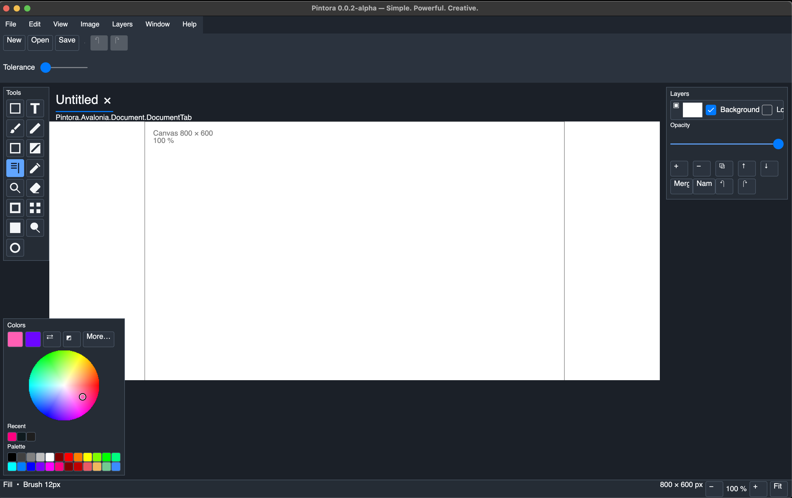

# Pintora

Pintora is a cross-platform raster editor focused on a familiar Paint.NET-style
workflow: a canvas in the center, dockable tool windows, document tabs, layers,
and direct keyboard shortcuts.



_Early UI preview. The Avalonia interface is still under active development._

## Current alpha

The current Avalonia alpha is **0.0.3-alpha**. It includes:

- document tabs with thumbnails and drag-to-reorder;
- a compact save/discard dialog for unsaved documents;
- a startup dialog for choosing the new image size;
- layers, history, colors, tools, zoom, and canvas navigation;
- shared raster algorithms used by platform adapters.

## Run from a release build

From the published application directory:

```sh
./Pintora
```

The application opens a new-image dialog first. Choose the canvas width and
height, then select **Create**.

## Build from source

```sh
dotnet build src/platform/avalonia/Pintora.Avalonia/Pintora.Avalonia.csproj -c Release
dotnet test tests/Pintora.Avalonia.Tests/Pintora.Avalonia.Tests.csproj --no-restore -m:1
```

See the [Paint.NET workflow notes](paint-net/README.md), [tool reference](tools/README.md),
and [algorithm migration inventory](algorithm-migration-inventory.md) for more detail.

## Project status

Pintora is an alpha project. UI behavior and platform boundaries are changing
as the GTK and Avalonia implementations are aligned around shared core logic.
